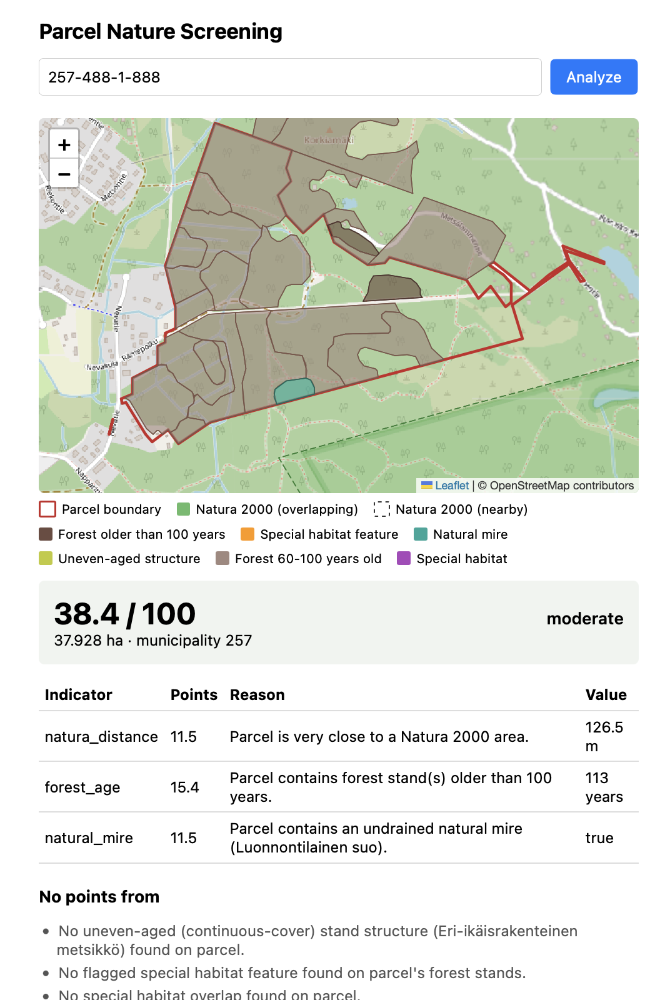

# Parcel Nature Screening

[](https://github.com/merihil/parcel-nature-screening/actions/workflows/ci.yml)

A GIS backend that evaluates environmental conservation value for cadastral parcels (kiinteistöpalsta) in Finland by combining several
spatial datasets, Natura 2000 protected areas, forest stand data, and cadastral parcel boundaries into a single
biodiversity-potential screening result.

Given a parcel's `property_id`, the API returns a preliminary score and the spatial evidence
behind it: Natura 2000 overlap, distance to the nearest protected site, forest stand age,
natural mire, uneven-aged forest structure, and flagged special habitat features. More
indicators planned. It is a learning/portfolio project, not an official conservation assessment
tool.



## Tech stack

Python · GeoPandas · PostGIS · PostgreSQL · SQLAlchemy · FastAPI · WFS APIs (MML, SYKE,
Metsäkeskus) · Docker

## Architecture

The pipeline runs in one direction: external WFS/API sources (MML, SYKE, Metsäkeskus) are
fetched and normalized by the ETL layer, then written into PostGIS, which serves as both the
analysis datastore and a cache of previously fetched areas. Analysis reads from PostGIS to
compute spatial indicators (Natura overlap, forest stand attributes), Scoring turns those into
a biodiversity-potential score, and FastAPI exposes parcel lookup and analysis over HTTP.

Full breakdown of each layer's responsibility: [`docs/architecture.md`](docs/architecture.md).
Why things are structured this way, including tradeoffs considered: [`docs/decisions.md`](docs/decisions.md).

## Documentation

- [`docs/architecture.md`](docs/architecture.md) — layers and module responsibilities
- [`docs/data_sources.md`](docs/data_sources.md) — what each external dataset is and why it's used
- [`docs/etl_pipelines.md`](docs/etl_pipelines.md) — how data is fetched, normalized and stored
- [`docs/decisions.md`](docs/decisions.md) — architecture decision records (ADRs)
- [`docs/learning_notes.md`](docs/learning_notes.md) — informal notes on what I've learned throughout the process of making this project
- [`docs/roadmap.md`](docs/roadmap.md) — what's done and what's planned


**A note on how this was built.** I used Claude Code while working on this project, not just for boilerplate but for
real architecture and debugging work. [`docs/learning_notes.md`](docs/learning_notes.md)
has an honest account of how that went, including a point where I had to stop and
change how I was using it, and how I work through the code now: understanding and
testing each piece myself rather than taking it on faith. It's the part of this
project I'd most want a reviewer to read.

## Getting started

### 1. Prerequisites

- Docker
- Python 3.11+

### 2. Configure environment

```bash
cp .env.example .env
```

Fill in `.env` with your own values:
- a database password for local use
- API credentials/endpoints for MML, SYKE and Metsäkeskus (see comments in `.env.example` for where to
request access).

### 3. Start PostGIS

```bash
docker compose up -d
```

This starts PostgreSQL/PostGIS and pgAdmin. The database starts empty; the next step sets up
the schema.

### 4. Install the package

```bash
python -m venv .venv
source .venv/bin/activate
pip install -e ".[dev]"
```

### 5. Apply database migrations

```bash
alembic upgrade head
```

Sets up the schema. Safe to run again — it just skips what's already applied.

### 6. Import some data

Import the Natura 2000 dataset (small, always imported in full):

```bash
python -m nature_screening.etl.import_nature_features
```

Parcels and forest stand data don't need a separate manual import — both are fetched
automatically, scoped to the parcel being screened, the first time it's requested through the
API (see [`docs/etl_pipelines.md`](docs/etl_pipelines.md)). You can still import a parcel by
hand if you want:

```bash
python -m nature_screening.etl.import_parcels --property-id 091-403-0063-0091
```

### 7. Run the API

```bash
uvicorn nature_screening.api.main:app --reload
```

Open `http://localhost:8000/docs` for interactive Swagger UI, or:

```bash
curl http://localhost:8000/parcels/091-403-0063-0091/analysis
```

## Testing

```bash
pytest
```

Runs the unit tests, no database needed. Tests that need PostGIS are marked
`@pytest.mark.integration` and skipped by default. With the database up, run them too:

```bash
pytest -m integration
```

## Project structure

```
src/nature_screening/
    config.py       application settings (pydantic-settings)
    db/              PostGIS connection, reads, writes
    geo/             WFS fetching, geometry normalization, AOI resolution
    etl/             one importer per data source, plus on-demand coverage fetch
    analysis/        indicators and scoring for a given parcel
    api/             FastAPI routes
alembic/             database migrations
sql/                 schema files, applied by the baseline migration
docs/                architecture notes, data sources, ADRs, learning notes, roadmap
tests/               unit tests, plus tests/integration/ (needs PostGIS)
```

## License

MIT — see [`LICENSE`](LICENSE).
